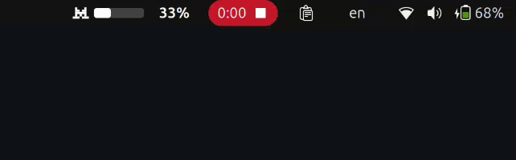
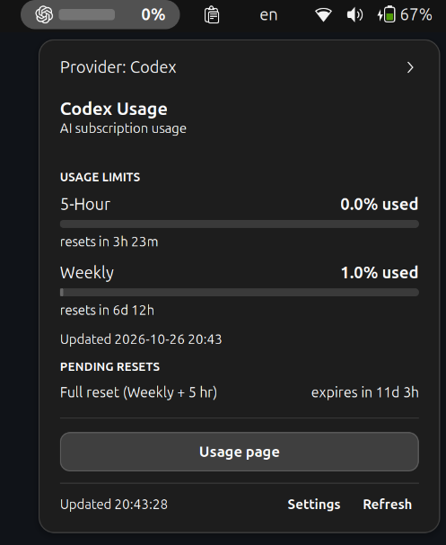
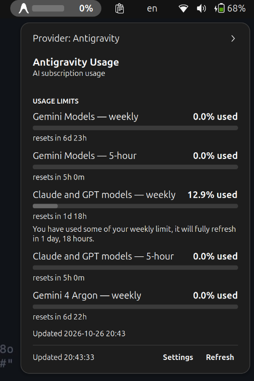
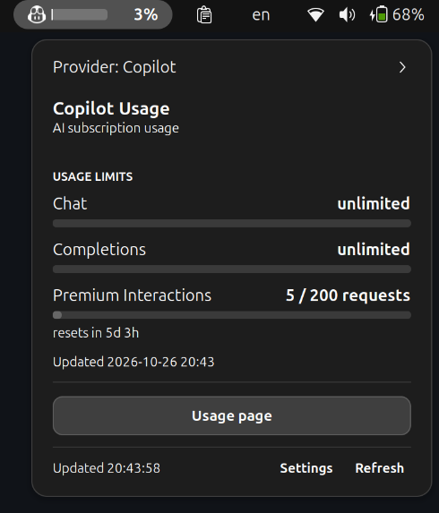
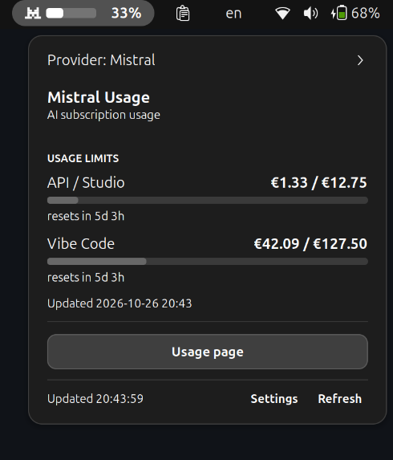
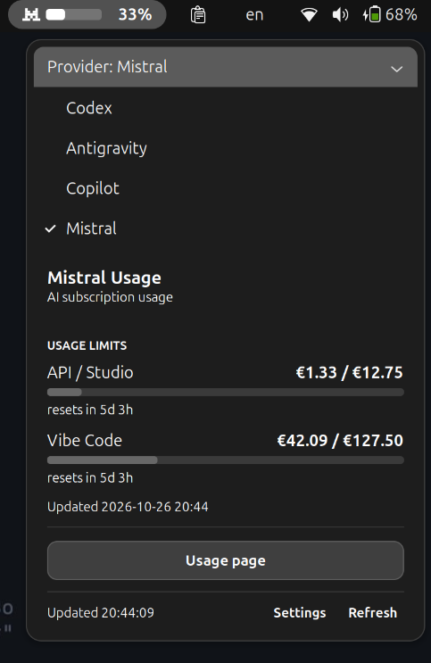
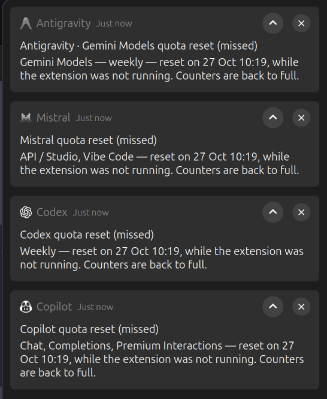

# llm-usage

[](https://hub.xerj.org/contributors/LuizGabrielTeixeira)

A GNOME Shell extension that shows your AI subscription usage in the top panel — one place to watch quotas from **OpenAI Codex**, **Google Antigravity**, **GitHub Copilot**, **Mistral** (including the student plans) and **Claude**.

Click the panel indicator for the full breakdown, scroll the mouse wheel over it to switch providers, or pick one from the **Provider** submenu.

> Fork of [kevinpita/codex-usage-extension](https://github.com/kevinpita/codex-usage-extension) (MIT), itself a fork of [Haletran/claude-usage-extension](https://github.com/Haletran/claude-usage-extension) (MIT). Menu/UI inspired by ClaudeCodeUsage (GPL) — **no GPL code or assets were copied**.

---

## Features

- Five panel display modes: ring only, ring + percentage, percentage only, progress bar only, or bar + percentage (with an optional provider icon)
- Per-provider sections with every quota window (e.g. Antigravity shows all its quota groups and both the weekly and 5-hour windows)
- Request counters where the plan is metered by requests (Copilot Premium Interactions: `4 / 200 requests`)
- Euro-denominated monthly pools for Mistral (`€5.00 / €50.00`)
- Reset countdowns per window
- Local quota-reset notifications with each provider's icon, kept in the notification list until dismissed (including resets missed while offline). Early renewals are inferred when usage drops and the next reset advances; a date correction alone stays silent. First observations only establish a baseline.
- Mouse-wheel cycling between providers (like GNOME workspace switching)
- Provider submenu with checkmark on the active provider
- Provider icons (drop your own in `icons/`)
- Manual refresh + auto-refresh interval
- Proxy support

## Providers

| Provider | Source | Requirements |
|---|---|---|
| **Codex** | `chatgpt.com` backend (`wham/usage`), reads the local Codex CLI session (`~/.codex/auth.json`) | [Codex CLI](https://developers.openai.com/codex/cli/) signed in |
| **Antigravity** | `agy` CLI usage report in JSON print mode (`agy -p /usage --output-format json`) | Antigravity CLI (`agy`) ≥ 1.1.11, signed in |
| **Copilot** | GitHub Copilot user quota endpoint (`api.github.com/copilot_internal/user`) using your GitHub CLI token | [GitHub CLI](https://cli.github.com/) (`gh`) signed in |
| **Mistral** | `admin.mistral.ai/subscription` page, fetched with your existing Firefox session (opt-in) | Firefox signed in to admin.mistral.ai |
| **Claude** | `api.anthropic.com/api/oauth/usage` via Claude Code OAuth (`~/.claude/.credentials.json`, opt-in), or `claude.ai/api/organizations/{id}/usage` via Firefox session (opt-in) | Claude Code signed in, or Firefox signed in to claude.ai |

Codex, Antigravity and Copilot are read-only public/user endpoints; nothing is ever posted anywhere.

### The Mistral & Claude Firefox option (why it is opt-in)

Mistral's official usage API (Admin API) is **Enterprise-only** — a Pro Student key (or any standard API key) cannot read usage, and the numbers only exist in the web console. Similarly, for Claude users who sign in via Firefox at `claude.ai` rather than the Claude Code CLI (`~/.claude/.credentials.json`), usage is only exposed on the web session endpoint. This extension handles both cleanly in an opt-in way:

1. The bundled Python helpers (`tools/mistral_web.py` and `tools/claude_web.py`, using `tools/firefox_cookies.py`) copy your Firefox `cookies.sqlite` to a private temp directory (mode `0600`, deleted right after reading — it lives for about a second).
2. Each helper reads only its site's session cookie **in memory only** (`admin.mistral.ai` or `claude.ai`) and performs a read-only GET (`admin.mistral.ai/subscription` HTML for Mistral, `claude.ai/api/organizations/{id}/usage` JSON for Claude).
3. Normalized usage windows are returned as sanitized JSON (percentages, amounts, reset timestamps only — never cookies, tokens or organization IDs).

The cookie is **never** stored, logged or written to GSettings. If you don't want any browser reading, leave the toggle off — Mistral shows an honest unavailable/blocked hint, and Claude uses Claude Code OAuth when signed in (showing an actionable sign-in hint otherwise).

Supported for the automatic fetch: native/Flatpak/Snap Firefox, Zen and LibreWolf. Chromium-family browsers encrypt their cookies and are not supported (the extension shows a clear sign-in state there).

## Privacy & security

- **No credentials are ever stored.** Codex, Claude OAuth (opt-in), and Copilot tokens are read from the CLIs you already trust (`~/.codex/auth.json`, `~/.claude/.credentials.json`, `gh auth token`) and used in memory for a single request.
- **Firefox session cookies** (Mistral and Claude opt-in) live in memory for one request and are then discarded; the temporary copy of `cookies.sqlite` is `chmod 0600`, in a private temp dir, deleted immediately after reading (see above).
- **GSettings contains no secrets** — UI preferences, opt-in toggles, and reset-notification baselines (reset dates, percentages and delivery markers). No monetary or request amounts are stored.
- Nothing is telemetry'd, uploaded, or shared. The extension makes no requests other than the usage endpoints listed in the table above.
- Errors are honest and actionable: signed out, quota page changed, provider disabled — each with advice on how to fix it.

## Account safety

Some providers restrict how subscription logins may be used by third-party tools, and may act on accounts without notice. The extension only sends read-only usage requests, identifies itself as `llm-usage`, and does not hide what it is, but the table shows what each provider reads so you can decide. Risk is a rough judgement, not a statement from the providers.

| Provider | What it reads | Risk | How to turn it off |
|---|---|---|---|
| Antigravity | Output of the official `agy` CLI (`agy -p /usage`); no tokens read | Low | Disable the provider in preferences |
| Claude (Claude Code login) | OAuth token in `~/.claude/.credentials.json` | Medium | Off by default; leave "Read Claude Code login" off |
| Claude (Firefox) | `claude.ai` session cookie | Medium | Off by default; leave "Fetch from Firefox session" off |
| Codex | Token in `~/.codex/auth.json` | Medium | Disable the provider in preferences |
| Copilot | `gh auth token` | Medium | Disable the provider in preferences |
| Mistral | `admin.mistral.ai` session cookie | Medium | Off by default; leave "Fetch from Firefox session" off |

Sources: [Anthropic legal and compliance](https://code.claude.com/docs/en/legal-and-compliance) (subscription OAuth is for Claude Code and Anthropic's own apps) and a [Gemini CLI maintainer statement](https://github.com/google-gemini/gemini-cli/discussions/20632) (Google acts on third-party tools that use Gemini CLI / Antigravity logins).

## Requirements

- GNOME Shell **46–50**
- `python3` (only for the opt-in Mistral/Claude Firefox fetches; stdlib only, no pip packages)
- Per provider: `codex`, `claude`, `agy` and/or `gh` CLIs signed in (all optional — each provider can be toggled off in preferences)

## Install

⚠️ GNOME Shell only loads extension code at session start — installing requires **logging out** once.

### With the script

```bash
./install
```

This copies the extension to `~/.local/share/gnome-shell/extensions/llm-usage@LuizGabrielTeixeira/`, compiles the schemas and logs you out.

### Manually

```bash
cp -r . ~/.local/share/gnome-shell/extensions/llm-usage@LuizGabrielTeixeira
cd ~/.local/share/gnome-shell/extensions/llm-usage@LuizGabrielTeixeira/schemas
glib-compile-schemas .
# then log out and back in
```

On **X11** you can avoid the logout: after copying, press `Alt+F2`, type `r`, press Enter (restarts the Shell in place). Not available on Wayland.

Enable it in the **Extensions** app (or `gnome-extensions enable llm-usage@LuizGabrielTeixeira`).

> **Migrating from codex-usage?** This is a different UUID (`llm-usage@LuizGabrielTeixeira`), so both can coexist — just disable/remove the old one and re-set your preferences once (the schema path is new).

## Uninstall

```bash
rm -rf ~/.local/share/gnome-shell/extensions/llm-usage@LuizGabrielTeixeira
# log out and back in
```

## Testing

```bash
python3 -m unittest discover -s tests -v   # full suite (JS contract + smoke suites run via gjs)
gjs -m tests/js/run.js                     # contract/normalization suite
gjs -m tools/validate-sources.js           # real one-shot fetch of all enabled providers, sanitized output
```

`validate-sources.js` exercises the exact same coordinator path the Shell uses. It prints statuses and percentages only — never tokens or cookies.

## Icons

Place `icons/<provider>.svg` or `icons/<provider>.png` (`codex`, `antigravity`, `copilot`, `mistral`, `claude`) to override the panel icon per provider — there is no extension-level fallback, so a provider without an icon simply shows no icon. Transparent PNG at 32px or a normal SVG works best; see `icons/README.md`.

## Showcase

Scroll the mouse wheel over the panel indicator to switch providers:

<p align="center">
  
</p>

Click the indicator for the full breakdown — one menu per provider — or pick one from the **Provider** submenu:

<table>
  <tr>
    <td align="center"></td>
    <td align="center"></td>
    <td align="center"></td>
  </tr>
  <tr>
    <td align="center"><b>Codex</b></td>
    <td align="center"><b>Antigravity</b></td>
    <td align="center"><b>Copilot</b></td>
  </tr>
  <tr>
    <td align="center"></td>
    <td align="center"></td>
    <td align="center"></td>
  </tr>
  <tr>
    <td align="center"><b>Mistral</b></td>
    <td align="center"><b>Provider submenu</b></td>
    <td align="center"><b>Reset notifications</b></td>
  </tr>
</table>


## Credits & license

- MIT — see [LICENSE](LICENSE). Copyright © 2026 Haletran, Kevin Pita, Luiz Gabriel Teixeira.
- Fork chain: [Haletran/claude-usage-extension](https://github.com/Haletran/claude-usage-extension) → [kevinpita/codex-usage-extension](https://github.com/kevinpita/codex-usage-extension) → **llm-usage**.
- Menu/UX inspiration: [ClaudeCodeUsage](https://github.com/dvdstelt/claude-code-usage) (GPL — used as inspiration only; no code or assets copied).

**Not affiliated** with OpenAI, Google, GitHub, Mistral or Anthropic. Provider names and icons are trademarks of their respective owners; the bundled icons are simple placeholders — replace them with your own if you plan to redistribute.
